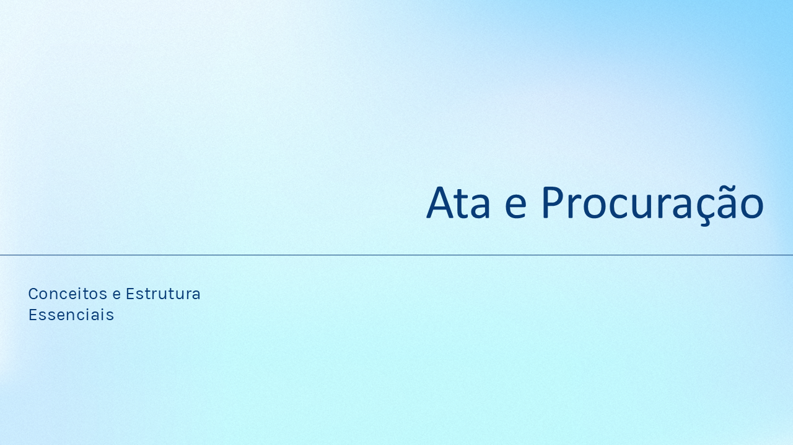

# ✍️ Comunicação e Expressão — Atividades do semestre

Atividades da disciplina de **Comunicação e Expressão** na **Fatec Taquaritinga**: variação linguística, leitura e interpretação, **coesão e coerência**, **redação empresarial**, **e-mail e carta formais**, **ata e procuração** e um trabalho final com análise de curta e dramatização de entrevista de emprego.

---

## 📋 Atividades

| # | Arquivo | Tema | O que tem |
|:---:|---|---|---|
| 01 | [`01-linguagem-variacao-e-estrategias-de-leitura.docx`](01-linguagem-variacao-e-estrategias-de-leitura.docx) | Linguagem e leitura | Variação linguística, preconceito linguístico, norma culta e leitura de sambas de Wilson Batista e Noel Rosa |
| 02 | [`02-concepcoes-de-texto-machado-de-assis.docx`](02-concepcoes-de-texto-machado-de-assis.docx) | Concepções de texto | Interpretação do episódio de Prudêncio, de *Memórias Póstumas de Brás Cubas*, e questão da VUNESP |
| 03 | [`03-coesao-e-coerencia.docx`](03-coesao-e-coerencia.docx) | Coesão e coerência | Referência de pronomes, conectivos e reescrita de textos com coesão |
| 04 | [`04-redacao-empresarial.docx`](04-redacao-empresarial.docx) | Redação empresarial | Modernização da linguagem empresarial e características do texto empresarial moderno |
| 05 | [`05-modernizacao-de-carta.docx`](05-modernizacao-de-carta.docx) | Carta | Reescrita de uma carta antiga em linguagem empresarial moderna |
| 06 | [`06-email-formal.docx`](06-email-formal.docx) | E-mail formal | E-mail de reclamação ao suporte técnico de internet |
| 07 | [`07-ata-e-procuracao.pptx`](07-ata-e-procuracao.pptx) | Ata e procuração | Apresentação em grupo: conceitos, estrutura e exemplos (12 slides) |
| 08 | [`08-trabalho-final-curta-meow-e-entrevista.docx`](08-trabalho-final-curta-meow-e-entrevista.docx) | Trabalho final | Análise do curta *Meow* e roteiro de entrevista de emprego para analista de sistemas |

---

## 📊 Apresentação: Ata e Procuração

| Documento | O que é | Elementos essenciais |
|---|---|---|
| **Ata** | Registro oficial e cronológico das decisões de uma reunião | Cabeçalho, local, data e hora, participantes, pauta, deliberações e assinaturas |
| **Procuração** | Documento que concede poderes a um representante | Identificação das partes, poderes conferidos, prazo, local, data e assinatura |

---

## 🧠 Conteúdos trabalhados

- **Variação linguística** e o papel da **norma culta** na vida acadêmica e profissional
- **Estratégias de leitura** e interpretação de textos literários e de canções
- **Coesão** (pronomes, conectivos) e **coerência** textual
- **Comunicação empresarial**: clareza, objetividade e concisão
- **Gêneros formais**: carta, e-mail, ata e procuração
- **Comunicação oral**: dramatização de entrevista de emprego

---

## 🎓 Informações acadêmicas

| | |
|---|---|
| **Instituição** | Fatec Taquaritinga |
| **Curso** | Análise e Desenvolvimento de Sistemas — 2º semestre |
| **Disciplina** | Comunicação e Expressão |
| **Professora** | Profa. Dra. Ana Paula dos Santos Martins |
| **Ano** | 2025 |

## 👤 Autor

**Juan Gabriel Pereira Augusto**
GitHub: [@JuanGabrielPereiraAugusto](https://github.com/JuanGabrielPereiraAugusto)

Atividades 07 e 08 feitas em grupo com **Carlos Eduardo Carvalho Geronimo**, **Daniel Freire Kim** e **Vitor Gomes de Oliveira**.
